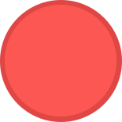

# Mac-OS-Traffic-Light-Buttons

a collection of SVG images inspired by the traffic light buttons macOS window bars: close, minimize, and maximize

## preview

### close:

  
  

### minimize:

  
  

### mximize:

  
  

